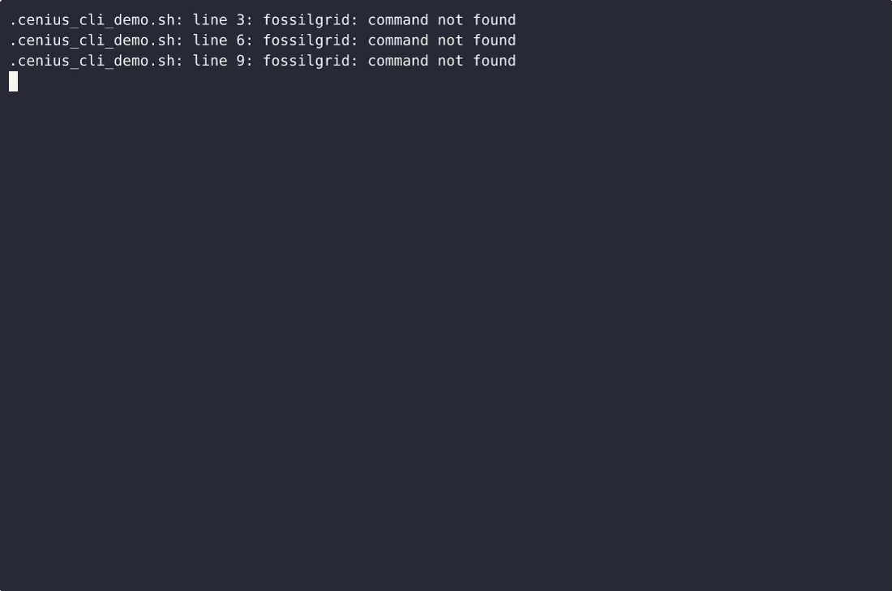

# FossilGrid — complete Full-stack app command-line tool example app

**FossilGrid** is Apache-2.0-licensed and fully open-source: a command-line tool written in Full-stack app that you can run, modify, and ship commercially without restrictions. FossilGrid is a single-file standard-library Python command-line tool with three subcommands: strata renders a Unicode/ASCII stratigraphic column from a CSV/JSON layer table; key builds a numbered dichotomous fossil i…. Grab FossilGrid from this repo and self-host it, or [remix it on cenius.ai](https://cenius.ai/marketplace/p/fossilgrid?ref=gh&utm_campaign=fossilgrid-webapp) — the platform grants full rebrand rights on every change.


[](LICENSE)  [](https://cenius.ai)

[](https://cenius.ai/marketplace/p/fossilgrid?ref=gh&utm_campaign=fossilgrid-webapp)

> **▶ [Open & edit in cenius.ai](https://cenius.ai/marketplace/p/fossilgrid?ref=gh&utm_campaign=fossilgrid-webapp)** — one click to an editable workspace: describe changes in plain English, get an instant preview, one-click deploy and host. Modifications made on the platform come with full rebrand & relicense rights.

_Local clone? See [Quick start](#quick-start) below. cenius.ai is the zero-setup path._

## Demo


▶ **[Watch the full demo video](https://cenius.ai/marketplace/p/fossilgrid?ref=gh&utm_campaign=fossilgrid-webapp)** — the complete walkthrough, playing on the project's cenius.ai page · [MP4 file](.github/media/demo.mp4)

## Screenshots



## Usage guide

Four walkthroughs, one per command, with the real output of the shipped example data. Every example
runs offline; nothing here needs an install.

Contents:

1. [Plot a measured section](#1-plot-a-measured-section)
2. [Build a dichotomous key](#2-build-a-dichotomous-key)
3. [Map a site grid](#3-map-a-site-grid)
4. [Convert coordinates and measure distances](#4-convert-coordinates-and-measure-distances)
5. [Scripting recipes](#5-scripting-recipes)

---

### 1. Plot a measured section

A measured section is a list of beds written down from the top of the outcrop to the base. The first
data row is the **topmost** layer; the last row is the base of the section. Write it as CSV
(`name,thickness_m,lithology,notes` — the last two columns are optional):

```csv
name,thickness_m,lithology,notes
Cross-bedded fluvial sandstone,1.5,sandstone,Sharp erosive base; mudstone clasts along the scour
Dark grey fissile shale,2.2,shale,Ammonites concentrated in the upper 40 cm
Nodular bioclastic limestone,0.8,limestone,Crinoid ossicles; bored hardground at the top
```

then

```sh
python3 fossilgrid.py strata plot examples/layers.csv --width 40
```

```
Stratigraphic column -- examples/layers.csv

Total thickness: 10.10 m across 6 layers
Top boundary depth from base: 10.10 m
Base boundary depth from base: 0.00 m
Scale: 1 rows per metre   Label width: 40 chars   Plot width: 12 chars

_Full guide: [`USAGE.md`](USAGE.md)_

## Features

- Stratigraphic column plotter
- Fossil ID dichotomous key generator
- Site grid mapping
- Unified CLI and subcommand orchestration
- Input validation and diagnostics

## Quick start

```bash
./install.sh   # installs dependencies + seeds demo data
```

See [`INSTALL.md`](INSTALL.md) for full setup and usage instructions.

## Architecture

No external services required: the entire command-line tool runs from this Full-stack app repo (18 files). Top-level layout: `examples/`. `./install.sh` gets you from a fresh clone to a running instance with sample data in a single step. See [`INSTALL.md`](INSTALL.md) for complete setup instructions.

## FAQ

### How do I get FossilGrid running locally?

Everything you need ships in this repo: clone it, run `./install.sh` to install dependencies and seed demo data, then follow [`INSTALL.md`](INSTALL.md) to start it. No external services required.

### Is FossilGrid editable without a developer?

[cenius.ai](https://cenius.ai/marketplace/p/fossilgrid?ref=gh&utm_campaign=fossilgrid-webapp) handles the implementation. Tell it what you want in everyday words, pick up the updated build. No coding needed.

### What technologies are in FossilGrid's stack?

Full-stack app end-to-end. Every file you need to run the app is here in this repository — code, configuration, seed data. Highlights include unified CLI and subcommand orchestration.

### Can I use FossilGrid in a commercial project?

The code is under the Apache-2.0 license, which allows commercial use without restriction. You can build, sell, and deploy it freely. Full text: [LICENSE](LICENSE).

### How do I customise FossilGrid's branding?

Yes — and the easiest way is [remixing it on cenius.ai](https://cenius.ai/marketplace/p/fossilgrid?ref=gh&utm_campaign=fossilgrid-webapp): modifications made on the platform come with full rebrand and relicense rights over your derivative.

## License & rebranding

Released under the [Apache License 2.0](LICENSE) (© 2026 Cenius AI) — free for personal and commercial use. The Cenius name/logo are trademarks (see NOTICE).

**Need a customized version?** [Remix this app on cenius.ai](https://cenius.ai/marketplace/p/fossilgrid?ref=gh&utm_campaign=fossilgrid-webapp) — modifications made on the platform come with **full rebrand & relicense rights** over your derivative.

## Built with cenius.ai

This entire application — code, design, seeded demo data — was generated on **[cenius.ai](https://cenius.ai)** from a plain-English description.

- 🚀 [Build your own app on cenius.ai](https://cenius.ai)
- 🎛️ [Remix FossilGrid on the marketplace](https://cenius.ai/marketplace/p/fossilgrid?ref=gh&utm_campaign=fossilgrid-webapp) — open it in a workspace, prompt for changes, and ship your own version.

More open-source apps: [the Cenius-ai catalog](https://github.com/Cenius-ai) · [showcase index](https://github.com/Cenius-ai/showcase)
